# Manual de usuario — RCS

Guía de operación para la revisión de publicaciones sísmicas.
Versión 1.11 — 16 de octubre de 2026.

Este manual está pensado para una persona con conocimientos básicos de
sismología que no necesita conocer el código. Explica, pantalla por pantalla,
qué hace el sistema y qué significa cada botón. El detalle interno (scripts,
parámetros, base de datos) está en el **`manual_tecnico.md`**.

> Las versiones anteriores (1.1 a 1.10, de octubre de 2026) quedaron
> archivadas en `docs/versiones/`. Este es el documento vigente.

---

## Índice

1. [Qué hace el sistema](#1-qué-hace-el-sistema)
2. [Requisitos e instalación](#2-requisitos-e-instalación)
3. [Antes de empezar: solicitud de catálogos](#3-antes-de-empezar-solicitud-de-catálogos)
4. [Ventana principal](#4-ventana-principal)
5. [Recorridos: procesar y consultar](#5-recorridos-procesar-y-consultar)
6. [El panel de análisis](#6-el-panel-de-análisis)
7. [Las pestañas de catálogo](#7-las-pestañas-de-catálogo)
8. [Parámetros y Estaciones del evento](#8-parámetros-y-estaciones-del-evento)
9. [Análisis rápido de sin arribos](#9-análisis-rápido-de-sin-arribos)
10. [Descargas](#10-descargas)
11. [Problemas frecuentes](#11-problemas-frecuentes)
12. [Nombres de las columnas](#12-nombres-de-las-columnas)
13. [Glosario](#13-glosario)

---

## 1. Qué hace el sistema

RCS **contrasta** lo que publicó el sistema automático de detección
sísmica (Seisan, en el servidor local) y el catálogo sísmico de SeisComp con el
**catálogo público** de eventos (consultado por `eventquery`). El objetivo es
responder preguntas concretas de control de calidad:

- ¿Qué eventos **no se publicaron** aunque el sistema los detectó?
- ¿Qué eventos **se publicaron con datos distintos** (latitud, longitud,
  profundidad o magnitud) de los procesados?
- ¿Qué eventos están **repetidos** dentro de una misma fuente?
- ¿Qué eventos quedaron **excluidos** y por qué?
- ¿Cómo se ubican los eventos respecto de la **zona de subducción** (perfiles)?

Además arma **mapas** y un **panel de análisis** por perfil, y marca como
**sospechosos** (posible mal localización) los eventos que no calzan con la
placa ni con la sismicidad histórica.

**Importante:** el sistema **no modifica** los datos de origen. Todo lo que
genera se escribe en archivos nuevos dentro de la carpeta desde donde se lanza.

---

## 2. Requisitos e instalación

El punto de entrada es el script `supervisor.sh`, que se ejecuta **desde la
carpeta del proyecto**:

```
./supervisor.sh
```

La primera vez crea un entorno virtual (`.venv`) e instala las dependencias
(puede tardar varios minutos). Requiere:

- **Python 3.7 o superior** y el paquete `python3-venv`.
- Un compilador y la biblioteca **GEOS** del sistema (para compilar Shapely).
  Si falla, el mensaje indica instalar `libgeos-dev`.

Todos los resultados se crean **junto a donde se ejecuta la app** (no junto al
código): las carpetas `datos/`, `informes/`, `descargas/`, `ploteo/` y
`trabajo/` se crean solas la primera vez.

También existe un **modo antiguo** para revisar un período suelto con el
catálogo ya elegido:

```
./supervisor.sh <archivo_entrada.csv> <archivo_salida.dat>
```

---

## 3. Antes de empezar: solicitud de catálogos

Al lanzar `./supervisor.sh` **sin argumentos** se abre la ventana de solicitud:


Campos y controles:

| Elemento | Para qué sirve |
|---|---|
| **Inicio** / **Fin** (`AAAAMMDDHHMMSS`) | El período a revisar, con 14 dígitos (año, mes, día, hora, minuto, segundo). |
| **Contraseña** `sysopr@10.54.217.9` | La clave del servidor remoto, donde viven los catálogos de Seisan y eventquery. |
| **Radio de estaciones SeisComp (km)** | Radio (por defecto 400 km) con el que se exportan las estaciones de SeisComp alrededor de cada evento. Solo afecta a SeisComp. |
| **En disco —** | Indicador (neutro) de qué archivos ya existen para el período escrito y si la exportación de SeisComp se va a reutilizar o a consultar. |
| **Avance** / **Actividad** | Barra de progreso y cronómetro, con una línea que dice qué se está obteniendo. |

Botones:

- **«Solicitar y descargar»**: baja del servidor lo que falte (Seisan y
  eventquery) y exporta la ventana de SeisComp para el mismo período.
- **«Ya los tengo (seguir)»**: abre la revisión sin bajar nada; exige que los
  archivos de esa ventana ya estén en la carpeta (si faltan, los lista en rojo).
- **«Salir»**: cierra.

Si hay varias ventanas de catálogos en la carpeta, la app **precarga la más
reciente** y lo avisa, así «Ya los tengo» funciona sin tipear las fechas.

---

## 4. Ventana principal

Al terminar la solicitud se abre la ventana principal:


Se divide en tres zonas: una **barra lateral** de acciones, la **barra de
pestañas agrupadas** y el **área de contenido** con el registro y los paneles al
final.

### Barra lateral

**PROCESAR**

- **«Procesar catálogos»**: el botón de trabajo principal. Corre el análisis
  (comparación, atribución, excluidos, repetidos) y, con los mismos catálogos,
  genera los paneles de todas las fuentes. Una sola pulsación deja todo listo.
  Si ya se procesó antes, pide confirmación antes de rehacer.
- Debajo, una etiqueta de estado: `Catálogos: sin procesar / procesados /
  procesando…`, y el aviso `✓ Catálogos OK.` o los que fallaron/faltan.

**CONSULTAR**

- **«Catálogos»**: abre una ventana con una pestaña por fuente (**SeisComp**,
  **Seisan**, **eventquery**) y el listado crudo de eventos de cada una.
- **«Repetidos»**: abre los informes de eventos repetidos.
- **«No publicados»**: abre el listado de eventos publicados que el sistema no
  publicó (magnitud ≥ 2.5), en una pestaña por fuente (SeisComp, Seisan).
- **«No actualizados»**: abre el listado de eventos publicados cuyos parámetros
  difieren de la solución de la fuente, en una pestaña por cada una (SeisComp,
  Seisan).
- **«Comparar agencias»**: consulta los catálogos de **EMSC**, **USGS** y
  **GFZ** (por API, para los cuadrantes continental/insular, Rapa Nui y
  antártico) y los compara con **nuestro catálogo publicado**. Pide una
  **magnitud mínima** y qué agencias consultar; al terminar abre una ventana con
  la **Comparación** (nuestros eventos con las soluciones de las agencias
  superpuestas, color por fuente, y el Δ de ubicación/profundidad/magnitud al
  hacer clic; el Δ de ubicación indica la **dirección cardinal** desde nuestra
  solución, p. ej. `Δ 10.3 km SE (ref. eventquery)`) y **Agencias sin
  contraparte** (eventos de agencia que no aparecen en lo nuestro).

**DESCARGAS**

- **«Abrir carpeta»**: abre la carpeta de descargas del análisis.

**RE-EXPORTAR**

- Tilde **«Forzar actualización»**: habilita los botones de re-exportar aunque
  el catálogo figure al día (por ejemplo, si se corrigió la fuente en el
  servidor).
- **«Seisan»** / **«eventquery»** / **«SeisComp»**: vuelven a obtener el
  catálogo correspondiente. Cada uno tiene a la derecha un **chip** con su
  estado: `✓ OK`, `✗ falló`, `✗ falta` o `⚠ cambió`. Sin el tilde, solo se
  habilita el que falta o cambió.
- **«Salir»**: cierra la aplicación.

> Re-importar un catálogo **obliga a reprocesar** todo el análisis, porque la
> información cruza datos entre catálogos. Al pulsar «Re-exportar» aparece un
> popup que lo avisa; si se acepta, tras la bajada el análisis corre solo.

### Barra de pestañas

Las pestañas se agrupan en filas: **Registro**; **Panel de mapas y perfiles**
(Seisan, eventquery, SeisComp); **No publicados** (Seisan, SeisComp); **No
actualizados** (Seisan, SeisComp). Los **Catálogos** ya no están en la barra:
se abren desde **«Catálogos»**, en la barra lateral.

- **Registro**: bitácora de lo que hace la app. Es lo primero que conviene
  mirar al terminar una etapa.
- **Panel de mapas y perfiles**: es donde están los **mapas y los perfiles de
  subducción** de cada fuente (Seisan, eventquery y SeisComp). Cada pestaña
  muestra la tabla de perfiles y el perfil de referencia; con doble clic en una
  fila se abre el detalle (mapa en planta y perfil).
- **No publicados** / **No actualizados**: son **paneles de mapas y perfiles**
  con los eventos de control de calidad (los no publicados y los publicados
  cuyos parámetros no coinciden). El mini-mapa muestra la solución de la fuente;
  al abrir el detalle de un perfil, los **no actualizados** muestran además la
  solución publicada (anillo negro con centro blanco) con el Δ. El listado completo en tabla está
  en las ventanas laterales **«No publicados»** y **«No actualizados»**.

Al pie hay una **barra de progreso** con la etapa en curso (por ejemplo,
`40 % · Comparando publicados v/s procesados`).

---

## 5. Recorridos: procesar y consultar

### Procesar

Pulse **«Procesar catálogos»** y siga el avance. Al terminar, en el **Registro**
figura cuántos eventos quedaron con perfil y cuántos sin perfil, con el motivo.

### Repetidos

Abre una tabla con los informes de repeticiones por fuente y filtro (amplio y
estricto). El panel de abajo muestra el informe seleccionado y **«Descargar
informe»** baja el completo:

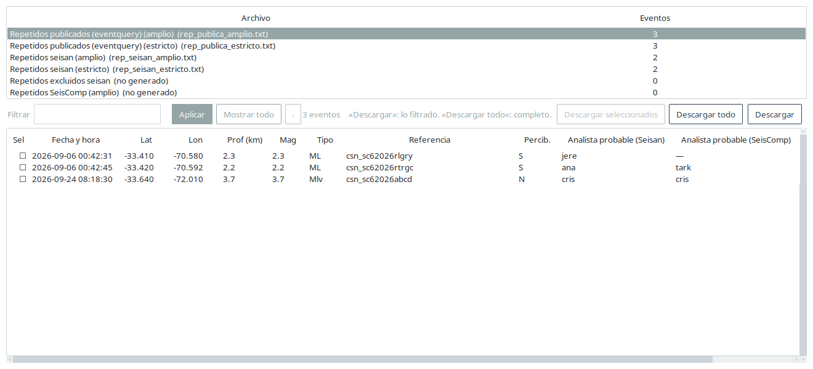

### No publicados

Listado de eventos que están en el catálogo público pero no en la solución
de la fuente, con filtro por texto y descargas:

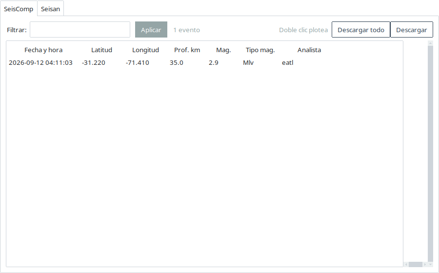

- **«Filtrar»** + **«Aplicar»** (o Enter): filtra el listado por texto libre
  (busca en todas las columnas). No se aplica al escribir.
- **«Descargar»** baja lo que se ve (con el filtro puesto); **«Descargar
  todo»** baja el listado entero.
- **Doble clic** en una fila (la ventana lo recuerda: «Doble clic plotea»)
  abre el evento en una figura con la vista en planta y el perfil de subducción,
  para ver su ubicación en contexto (contra el *slab* y la sismicidad histórica)
  y juzgar de inmediato si, por localización, debería estar publicado:


### No actualizados

Listado de eventos **sí publicados** pero cuyos parámetros difieren de los
procesados. Muestra, por parámetro, el valor de la fuente y el publicado, los
deltas, la **distancia (km)** entre ambas ubicaciones y una columna final con
**qué parámetros discreparon**. Tiene un filtro por texto que se aplica con
**«Aplicar»** (o Enter), no al escribir:

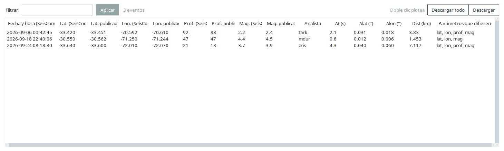

La comparación es **numérica**. Como el catálogo publicado (el que arma
«publica») guarda lat/lon con **2 decimales** y la solución de la fuente con 3,
las coordenadas se comparan con una **tolerancia de 0,005°** (media centésima)
para no marcar como distinto el mismo evento por el redondeo de la publicación.
Profundidad y magnitud se comparan **exactas a 1 decimal**. Se puede ordenar por
cualquier columna (incluida **Dist (km)**) haciendo clic en su encabezado.

**Doble clic** en una fila abre la figura de planta + perfil con **las dos
soluciones**: el **evento Seisan/SeisComp** (amarillo) y el **publicado** (anillo
azul con centro blanco), unidos por una línea y con el **Δ de ubicación** (con su
**dirección cardinal**), de **profundidad** y de **magnitud** (abajo a la derecha;
la magnitud aparece solo si difiere, y con el **tipo** cuando cambia, p. ej.
`Mlv vs ML`). Así se ve en el
mapa la diferencia hipocentral, no solo el km de la tabla:


Además del listado, el grupo **No actualizados** de la barra de pestañas abre un
**panel de mapas y perfiles** de los eventos de la fuente que quedaron
desactualizados. Su mini-mapa muestra la solución de la fuente; al abrir el
detalle de un perfil se dibujan **las dos soluciones** (de la fuente y publicada)
con una línea y el Δ por cada evento (el de ubicación, con su **dirección
cardinal**).

### Comparar agencias

**«Comparar agencias»** (barra lateral) consulta por API los catálogos de
**EMSC**, **USGS** y **GFZ** para los cuadrantes continental/insular, Rapa Nui y
antártico, y los compara con **nuestro catálogo publicado**. El diálogo pide la
**magnitud mínima** (que filtra nuestro catálogo y se usa como mínimo en la
consulta a las agencias) y qué agencias consultar.

La **referencia es fija** hoy: el **catálogo de eventos publicados extraído
(eventquery)**; la comparación se hace solo contra ese catálogo. El diálogo lo
recuerda con una línea («Se compara contra catálogo de eventos publicados
extraído (eventquery)»).

Por defecto se consulta la **ventana del análisis**. Con la casilla
**«Desde/Hasta»** se consulta un **rango elegido** (UTC): los campos **«Desde
(UTC)»** y **«Hasta (UTC)»** tienen un **calendario** para el día y un campo
**`HH:MM:SS`** para la hora. El **Desde** trae por defecto el **inicio del
análisis** (la extracción anterior) y el **Hasta** el **instante en que se abre
el diálogo**; ambos son editables (y hay un botón **«Ahora»** para el Hasta). Al
marcar la casilla se activan solas (y se pueden destildar) **«Volver a consultar
las agencias»** y **«Actualizar el catálogo publicado (eventquery)»**. Actualizar
eventquery pide la **contraseña del servidor** y re-baja el catálogo **hasta el
«Hasta» elegido**; si esa bajada falla, se avisa y se compara contra el
eventquery del análisis. La referencia fresca se usa **solo para esta
comparación**: el resto del análisis (No publicados, No actualizados, etc.) sigue
calculado sobre la ventana cargada y **no se altera**. Ojo: las soluciones muy recientes pueden ser
**preliminares** (luego las agencias las revisan) y **GFZ llega con ~1 día** de
atraso; EMSC y USGS están casi en tiempo real. Con la misma ventana elegida, si
vuelves a abrir dentro de los **15 minutos**, se reusa lo ya consultado; pasado ese plazo
se vuelve a consultar.

Cuando no cambió nada (misma ventana, magnitud, agencias y catálogos), la
comparación **no se rehace**: se reutiliza el resultado y la ventana lo indica en
una etiqueta, **`Reutilizada · AAAA-MM-DD HH:MM:SS UTC`** (o **`Ejecutada · …`**
si se acaba de correr). Todas las horas van en **UTC**. Debajo se muestra la
**ventana solicitada** (común a las agencias) y un botón **«Cobertura por
agencia»** que abre una tabla con la **ventana real** de cada una (`Agencia ·
Eventos · Desde (UTC) · Hasta (UTC) · Rezago`): son el primer y el último evento
que reportaron —no la cobertura total del catálogo— y el rezago es cuánto antes
del fin solicitado terminó cada catálogo (por ejemplo, GFZ). Esa misma cobertura
se incluye en la **descarga**.

Al terminar se abre una ventana con dos pestañas, cada una con el **mapa** (panel
de perfiles) y, debajo, un **listado por evento** con las columnas
`Fecha_Hora · Latitud · Longitud · Prof. · Mag. · Agencias · Δmáx (km)`:

- **Comparación**: **nuestros eventos publicados**; en el detalle (planta +
  perfil) se ven, con un **color por fuente**, la solución nuestra y las de las
  agencias que reportaron el mismo evento. Nuestra solución va **rellena**
  (**rojo** si fue **percibida**, **amarillo** si no), con borde negro, para
  distinguirse del mar; las agencias usan su propio color. Al hacer clic en un
  evento, su viñeta muestra los **Δ (ubicación, profundidad y magnitud)** de cada
  agencia; el Δ de ubicación da la **dirección cardinal** desde nuestro publicado,
  p. ej. `Δ 10.3 km SE (ref. eventquery)`. El listado trae una fila por evento con
  las fuentes asociadas (`CSN + EMSC + …`).
- **Agencias sin contraparte con CSN**: eventos de las agencias que **no**
  aparecen en nuestro publicado (posibles sismos que no publicamos), agrupando
  en una fila las soluciones de **distintas agencias** que son el mismo evento.

Con **doble clic** en una fila de estos listados se abre (en ventana aparte) la
**planta + perfil** del evento con las fuentes que indica la columna **Agencias**
(en la comparación, nuestra solución + cada agencia; en sin contraparte, las
agencias asociadas).

Cuando dos soluciones caen **en la misma ubicación** (una agencia adoptando la de
otra), se marcan con un **aro magenta** («Soluciones superpuestas» en la leyenda)
en la planta y en el perfil; en el listado, esas fuentes aparecen unidas por
**`≡`** (p. ej. `CSN + EMSC≡USGS`). Al **hacer clic** sobre una superposición, la
viñeta muestra primero la **identificación del evento** —el **id** y la
**fecha/hora** (`AAAA-MM-DD HH:MM:SS`) de nuestro evento publicado (eventquery)—
y luego lista **todas** las fuentes con su profundidad, magnitud y tipo, y —en la
comparación— el **Δ de cada una** respecto de nuestro publicado (con la
**dirección cardinal**, p. ej. `Δ 10.3 km SE (ref. eventquery)`).

Si el listado supera las **2000** filas, se muestra un aviso («Mostrando 2000 de
N — usa «Descargar» para el listado completo») y la descarga trae todo. Cuando no
hay datos para plotear, la app lo **avisa por pantalla** (no solo por consola).

Ambas pestañas tienen un botón **«Descargar»**: la de **Comparación** baja en un
paso los dos formatos de la lista (una fila por par, y una fila por solución)
según `descargas/`; la de **Agencias sin contraparte** baja su propio listado.

La comparación se **reutiliza** si ningún catálogo cambió: al volver a abrirla
con la misma ventana, magnitud y agencias, se muestra al instante lo ya
procesado. Solo se vuelve a consultar/calcular cuando cambió algún catálogo
(nuestro publicado o el de alguna agencia) o cuando se tilde **«Volver a
consultar las agencias»**.

---

## 6. El panel de análisis

Las pestañas del grupo **Panel de mapas y perfiles** de cada fuente muestran el
panel de análisis: a la izquierda la tabla de perfiles de subducción y a la
derecha un mini-perfil de referencia.


### Tabla de perfiles

| Columna | Qué indica |
|---|---|
| **#** | Número de orden. |
| **Perfil** | Identificador del perfil de subducción (p. ej. `P005`). |
| **Ev** | Cantidad de eventos asignados a ese perfil. |
| **Sospechosos** | Cuántos de esos eventos quedaron marcados como sospechosos. |
| **Percibidos** | Cuántos fueron reportados como percibidos por la población. |
| **Along (km)** | Rango de distancia a lo largo del perfil. |

Los perfiles con sospechosos se muestran en rojo.

### Mini-perfil

Dibuja el perfil seleccionado: topografía, el contacto de placas (*slab*) y los
eventos. Los **sospechosos** llevan un **aro violeta grueso**, cualquiera sea su
fuente (rojo si el CSN fue percibido, amarillo si no, o el color de la agencia).
Al seleccionar una fila se redibuja.

### Botones

- **«Abrir detalle»**: abre los mapas del perfil seleccionado (equivale a doble
  clic en la fila).
- **«Mapas sin perfil»**: abre los eventos que quedaron sin perfil, agrupados
  por territorio (Nacional, Insular, Antártico).
- **«Solo sospechosos»** (cambia a **«Todos los perfiles»**): filtra la tabla a
  los perfiles con al menos un sospechoso.
- **«Inicio»**: vuelve al estado inicial (sin filtro).
- **«Sismicidad histórica»**: prende/apaga el fondo de sismicidad histórica.
- **«Descargar»**: baja eventos de un ámbito (ver [Descargas](#10-descargas)).

En las figuras de detalle hay una barra de herramientas de matplotlib
(*zoom*, *pan*, guardar). En modo *zoom* o *pan*, un clic selecciona un evento y
un arrastre hace zoom o mueve la vista; **Esc** sale del modo. El botón
**«Detener»** (rojo, abajo a la derecha) cierra las figuras de detalle.

---

## 7. Las pestañas de catálogo

La ventana **«Catálogos»** (barra lateral) tiene una pestaña por fuente:
**SeisComp**, **Seisan** y **eventquery**. En las tres, la lista comparte la
ventana con una **miniatura del perfil** del evento seleccionado: al elegir una
fila —con el mouse o con las flechas del teclado— la miniatura se redibuja con el
perfil de ese evento. La miniatura usa el mismo perfil del panel de análisis, con
los ejes comparables, y para un evento sin perfil asignado (fuera de cobertura o
sin coordenadas o profundidad) muestra un aviso en lugar del dibujo.

La casilla **«Sismicidad histórica»** de la barra superior agrega o quita el
fondo de sismicidad histórica en la miniatura. Afecta **solo** a la miniatura
(las ventanas de detalle siempre traen el fondo) y es independiente en cada
pestaña.

Los filtros de texto, magnitud y coordenadas **no se aplican al escribir**: se
escriben y se aplican con el botón **«Aplicar»** (o Enter en cualquier casilla).
Así, con catálogos grandes, no se reconstruye la tabla en cada tecla.

### Pestaña de SeisComp

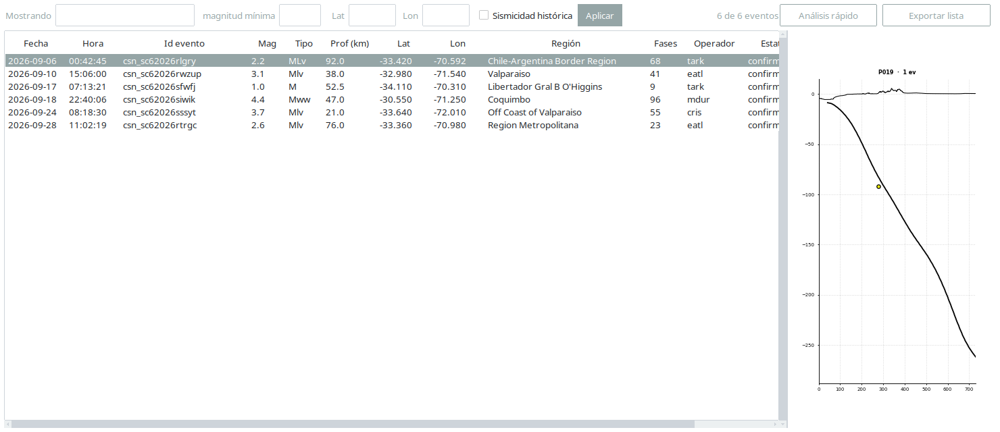

Controles de la barra superior:

- **«Mostrando»**: filtro de texto libre (busca en todo lo visible).
- **«magnitud mínima»**: filtra por magnitud.
- **«Lat»** / **«Lon»**: filtran por latitud/longitud.
- **«Aplicar»** (o Enter): aplica los filtros anteriores.
- **«Sismicidad histórica»**: agrega o quita ese fondo en la miniatura.
- **«Análisis rápido»**: abre la revisión acotada de *sin arribos* (ver
  [sección 9](#9-análisis-rápido-de-sin-arribos)). Solo aparece si la
  exportación trae el archivo de estaciones sin arribos.
- **«Exportar lista»**: baja el listado con el filtro y el orden en pantalla.

Se puede **ordenar por cualquier columna** haciendo clic en su encabezado (un
clic ordena ascendente, otro descendente).

### Pestañas de Seisan y eventquery

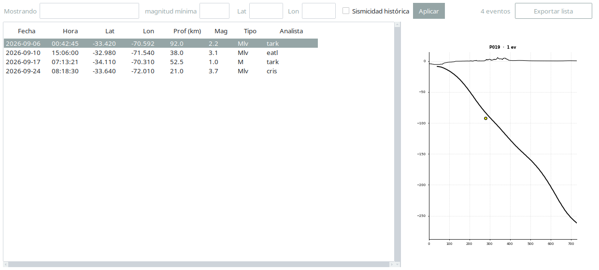

Son listados simples (sin detalle de llegadas), con su propio filtro por texto,
magnitud mínima y coordenadas (también con **«Aplicar»** o Enter), y la misma
casilla **«Sismicidad histórica»** para la miniatura.

### Abrir un evento

El detalle del evento abre aparte, y difiere según la fuente:

- En **SeisComp**, al hacer **doble clic** en una fila (o Enter con la fila
  elegida) se abren los **Parámetros del evento** en una ventana aparte, que se
  reutiliza al cambiar de evento y **no bloquea** la lista. Desde ahí, el botón
  **«Planta y perfil»** plotea la vista en planta y el perfil del evento.
- En **Seisan** y **eventquery**, que no tienen esa ventana de parámetros, el
  **doble clic** (o Enter) plotea directamente planta + perfil del evento.

---

## 8. Parámetros y Estaciones del evento

### Parámetros del evento

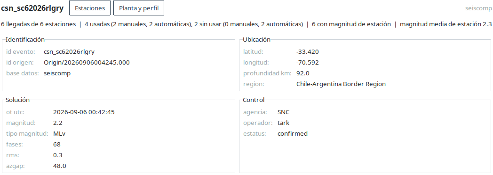

Muestra los datos del evento agrupados en **Identificación**, **Ubicación**,
**Solución** y **Control** (donde está el **operador/analista**). El botón
**«Estaciones»** abre la ventana de estaciones, y **«Planta y perfil»** plotea la
vista en planta y el perfil del evento en una ventana nueva.

### Estaciones del evento

Tiene dos solapas. En el encabezado, **siempre visible**, van los parámetros del
evento y el **analista** en negrita, para no perder de vista qué evento se está
mirando.

**Solapa «Con arribos»**: las llegadas de la solución preferida, agrupadas por
estación. Muestra, por cada *pick*, si fue **manual o automático**, con su autor,
agencia y método. Los *picks* manuales se resaltan (fuerte si entraron a la
solución, suave si quedaron afuera):

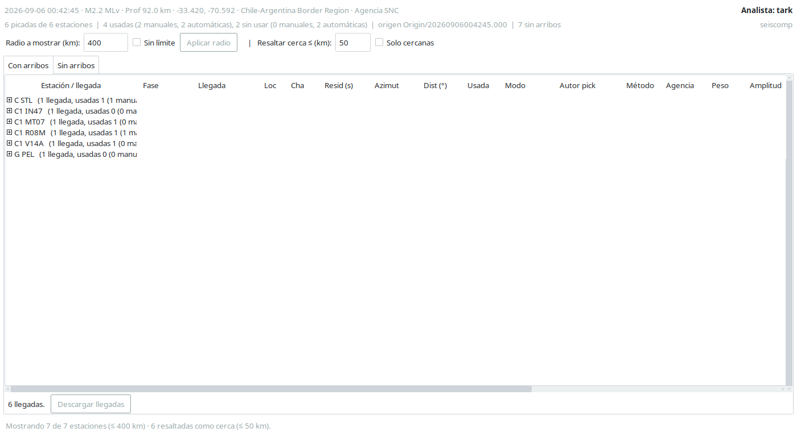

**Solapa «Sin arribos»**: las estaciones que estaban configuradas en el
inventario y quedaron dentro del radio, pero **no tienen arribos** en el origen
preferido:

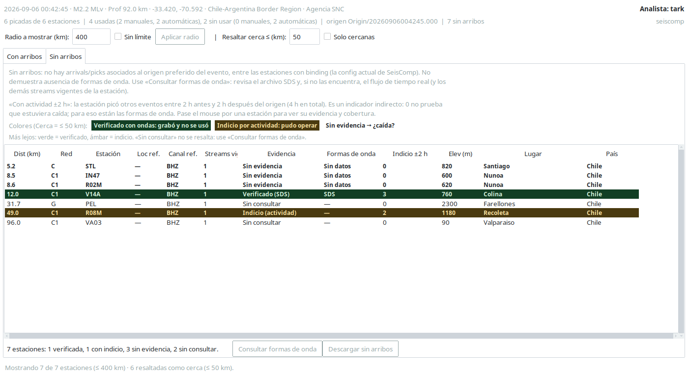

> **Ojo:** «sin arribos» **no** significa «no grabó». La base de SeisComp no sabe
> qué estaciones tienen formas de onda de cada evento; eso vive en el archivo de
> ondas. Por eso la columna **«Actividad ±24 h»** es solo un indicador indirecto:
> cuenta otros eventos que esa estación picó entre 24 h antes y 24 h después del
> origen (48 h en total). Un 0 no prueba que la estación estuviera caída.

El resaltado cruza dos umbrales independientes del radio:

- **fondo destacado** — *cerca **y** con actividad*: estaba operando cerca y
  **no se usó** en la solución (posible pérdida de calidad).
- **verde** — *con actividad, más lejos*.
- **negrita** — *cerca **y** sin actividad*: **¿caída?**.
- **normal** — *lejos y sin actividad*.

Controles del encabezado (bloque **Distancias**):

- **«Radio a mostrar (km)»**: **recorta** la lista ya exportada; no consulta
  la base. Arranca con el radio de la exportación (400 km por defecto).
- **«Sin límite»**: al marcarlo, **«Aplicar radio»** consulta la base sin tope
  de distancia (ignora el radio) y muestra el resultado en otra ventana.
- **«Resaltar cerca ≤ (km)»**: umbral de resaltado «cerca» (50 km por defecto).
  **Solo cambia el color, no recorta la lista.** Se aplica en vivo mientras
  escribes.
- **«Solo cercanas»**: marcado, recorta la lista a las estaciones dentro del
  umbral «cerca» (además del radio). Se aplica de inmediato, sin consultar la
  base.
- **«Aplicar radio»** (o Enter en la casilla de radio): si el radio pedido no
  supera el de la exportación (o «Sin límite» está desmarcado y no hay
  archivo de sin arribos), aplica el recorte sobre la lista cargada y el estado
  de «Solo cercanas»; si lo supera, **consulta la base** y abre el resultado en
  otra ventana.

Debajo de los controles hay una **línea de estado** que aclara qué se está
viendo, por ejemplo: *«Mostrando 7 de 7 estaciones (≤ 400 km) · 6 resaltadas
como cerca (≤ 50 km)»*. Si cambias el radio y no lo aplicaste, agrega
*(radio sin aplicar)*.

Cada solapa tiene su botón de descarga (**«Descargar llegadas»** /
**«Descargar sin arribos»**).

---

## 9. Análisis rápido de sin arribos

El botón **«Análisis rápido»** del catálogo de SeisComp recorre **TODO el
catálogo** (no usa el filtro del panel, y lo advierte) y lista los eventos que
tienen estaciones **sin arribos cercanas**, para acotar la revisión a esos
casos.

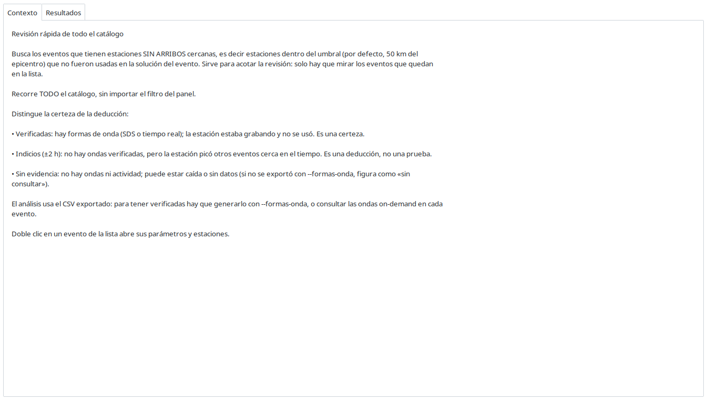

La pestaña **Contexto** explica en corto qué mide y cómo se lee.

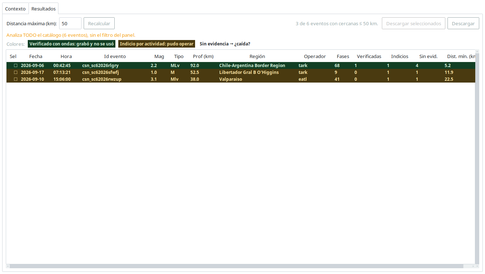

La pestaña **Resultados** trae los datos clave del evento y el **operador**, más
cuántas estaciones cercanas son *con actividad* (**no se usó**) y cuántas *sin
actividad* (**¿caída?**). Controles:

- **«Distancia máxima (km)»** + **«Recalcular»**: cambian el umbral y recalculan
  en el acto.
- Clic en un encabezado: reordena (ascendente → descendente → vuelta al orden
  por severidad, marcado con ▲/▼).
- **«Descargar»**: baja el resultado en formato largo (una fila por evento y
  estación cercana).
- **Doble clic** en un evento: abre sus parámetros y estaciones.

---

## 10. Descargas

Todo lo que se baja va a la carpeta **`descargas/`** dentro de la carpeta del
análisis, y se abre con **«Abrir carpeta»**. Al descargar, la app pregunta el
formato:

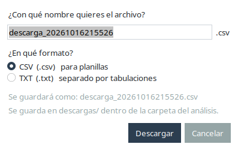

- **CSV** (separado por comas), para planillas.
- **TXT** (separado por tabulaciones), para pegar en planillas.

El diálogo recuerda el formato de la descarga anterior. En las vistas con tabla,
**«Descargar»** arma el archivo con el **filtro y el orden en pantalla**, y
**«Descargar todo»** lo escribe entero.

---

## 11. Problemas frecuentes

- **Un catálogo no se pudo bajar.** La app ya no se detiene: avisa cuáles
  quedaron afuera y habilita el botón de **Re-exportar** correspondiente.
- **«La base no responde» al ampliar.** La ampliación necesita conexión a la
  base de SeisComp; si no está, avisa y deja el corte exportado como estaba.
- **La solapa «Sin arribos» dice que falta el archivo.** Es una exportación
  anterior a la función de sin arribos; hay que **re-exportar** la ventana.
- **La ventana se achicó / no se ve completa.** La app **solo crece**; si un
  monitor es chico, use las barras de desplazamiento de cada tabla (horizontal y
  vertical).
- **Un evento quedó «sin perfil».** No siempre es un error: puede estar fuera de
  la cobertura de las grillas. El Registro y el conteo de perfiles indican el
  motivo.
- **La pantalla se congeló** (el mouse no responde ni en el escritorio). Suele
  pasar cuando la pila gráfica está frágil: el kernel reporta fallas de
  *modeset* de nvidia y/o hay AnyDesk activo. Qué hacer:
  1. **No pierdas el trabajo**: la app sigue viva; si puedes, mátala desde otra
     terminal (`pkill -f app.py` por SSH) — el directorio de trabajo no se
     toca.
  2. **Cierra AnyDesk** durante las sesiones largas (inyecta entrada y puede
     interferir con la sesión gráfica).
  3. Si el mouse sigue muerto, **reinicia la sesión gráfica** (cerrar la sesión
     de X) o la máquina.
  4. **Mira el registro**: todo lo que la app loguea va a
     `informes/app.log` del directorio de trabajo (con hora y errores). Ahí
     también aparecen avisos si AnyDesk estaba activo o si hubo fallas de
     modeset al arrancar.
  5. Para el futuro: la app ahora avisa al arrancar si detecta AnyDesk o
     fallas de modeset recientes en el registro del kernel.

---

## 12. Nombres de las columnas

Varias tablas usan abreviaturas o nombres que no se explican solos. Aquí está qué
significa cada uno, por vista. Lo que no figura en esta sección es de lectura
directa (fecha, hora, latitud, longitud, profundidad, magnitud, tipo, etc.).

### Comparar agencias — listado

| Columna | Qué indica |
|---|---|
| **Agencias** | Fuentes que reportaron ese evento, separadas por `+` (p. ej. `CSN + EMSC + USGS`). Las que caen en la misma ubicación se unen con `≡`. |
| **Δmáx (km)** | Distancia máxima, en km, entre las soluciones agrupadas de ese evento. |

### Comparar agencias — cobertura por agencia

| Columna | Qué indica |
|---|---|
| **Rezago** | Cuánto antes del fin solicitado terminó el catálogo de esa agencia (p. ej. GFZ llega con ~1 día de atraso). |

### Comparar agencias — descarga

| Columna | Qué indica |
|---|---|
| **Δt (s)** | Diferencia de tiempo, en segundos, respecto de nuestra solución. |
| **Dist (km)** | Distancia, en km, entre la solución de la agencia y la nuestra. |
| **Δprof (km)** | Diferencia de profundidad, en km. |
| **Δmag** | Diferencia de magnitud. |
| **Fuera de rango** | Marca la solución que excede la tolerancia de asociación (más de 6 s o más de 0.25° de separación): se lista, pero no se considera el mismo evento. |
| **Referencia** | Nuestro evento publicado que se toma como referencia del cruce. |
| **Asociado** | En el formato largo, la agencia cuya solución se asoció a la referencia. |
| **Fuente** | Origen de la fila (nuestra solución o una agencia). |

### Panel de análisis — tabla de perfiles

| Columna | Qué indica |
|---|---|
| **Along (km)** | Rango de distancia, a lo largo del perfil, que cubren los eventos de ese perfil. |

### Descarga de eventos

| Columna | Qué indica |
|---|---|
| **Along (km)** | Posición del evento a lo largo del perfil (km desde el inicio de la sección). |
| **Perp (km)** | Distancia lateral del evento al eje del perfil. |
| **Residuo (km)** | Diferencia entre la profundidad del evento y la del *slab* en su posición `along`. |
| **Dist. asoc. (km)** | Distancia de asociación usada para elegir el perfil (combina la distancia lateral y el residuo de profundidad). |
| **Motivo** | Por qué el evento quedó **sin perfil** (p. ej. fuera de cobertura al norte/sur, en el extremo, o fuera del umbral). |

### Estaciones del evento — con arribos

| Columna | Qué indica |
|---|---|
| **Loc** | Localización (código de 2 dígitos) del stream de la estación. |
| **Cha** | Canal del stream (p. ej. `HHZ`). |
| **Resid (s)** | Residual del arribo: diferencia entre el tiempo observado y el teórico, en segundos. |
| **Azimut** | Ángulo, en grados, de la estación respecto del epicentro. |
| **Dist (°)** | Distancia epicentral, en grados. |
| **Usada** | Si el arribo entró a la solución preferida. |
| **Modo** | Si el *pick* fue **manual** o **automático**. |
| **Peso** | Peso del arribo en la solución. |
| **SNR** | Relación señal-ruido del arribo. |
| **QC** | Marca de control de calidad del *pick*. |
| **Residuo** | Residual del arribo (misma idea que **Resid (s)**). |
| **Elev (m)** | Elevación de la estación, en metros. |

### Estaciones del evento — sin arribos

| Columna | Qué indica |
|---|---|
| **Loc ref.** | Localización del stream de **referencia** de esa estación. |
| **Canal ref.** | Canal del stream de **referencia**. |
| **Streams vig.** | Cuántos streams de esa estación había vigentes. |
| **Actividad ±24 h** | Cuántos *otros* eventos picó esa estación entre 24 h antes y 24 h después del origen. |

### Análisis rápido de sin arribos

| Columna | Qué indica |
|---|---|
| **Destacadas** | Estaciones cercanas **y** con actividad que **no** se usaron en la solución. |
| **Cercanas** | Estaciones cercanas sin actividad (posible caída). |
| **Dist. mín. (km)** | Distancia a la estación sin arribos más cercana al evento. |
| **Clasificación** | Categoría del evento en el análisis (según las estaciones cercanas). |

### Catálogo de SeisComp

| Columna | Qué indica |
|---|---|
| **Estatus** | Estado de revisión del evento en SeisComp (p. ej. `reviewed`). |
| **Base** | Base de datos de origen del registro. |
| **Fases** | Cantidad de fases (arribos) del evento. |

### Catálogo eventquery

| Columna | Qué indica |
|---|---|
| **Percib.** | Si el evento fue reportado como percibido por la población. |
| **Referencia** | Texto de referencia del evento en el catálogo público. |
| **Analista probable** | Analista que probablemente registró el evento (deducido por el patrón de *picks*). |

---

## 13. Glosario

- **Evento**: un sismo con su solución (hora, latitud, longitud, profundidad,
  magnitud).
- **Origen preferido**: la solución hipocentral que el sistema elige como
  principal para un evento.
- **Arribo / *pick***: la lectura de una fase (P, S…) en una estación. Un *pick*
  es **manual** si lo hizo un analista y **automático** si lo hizo el autopicker.
- **Catálogo público (`eventquery`)**: los eventos publicados oficialmente.
- **`select` / Seisan**: la selección y la solución procesadas por Seisan.
- **SeisComp**: el sistema de adquisición y procesamiento que aporta su propia
  solución, inventario y *bindings*.
- **No publicado**: evento detectado localmente que no aparece en el catálogo
  público.
- **No actualizado**: evento publicado cuyos parámetros difieren de la solución
  de la fuente (Seisan o SeisComp).
- **Repetido**: dos o más eventos que coinciden en tiempo y coordenadas dentro de
  una tolerancia.
- **Excluido**: evento del `select` al que le faltan datos (magnitud, coordenadas
  o RMS).
- **Perfil de subducción**: una sección a lo largo de la zona de subducción a la
  que se asigna cada evento.
- **Sospechoso**: evento posiblemente mal localizado (no calza con la placa ni
  con la sismicidad histórica), o sin perfil asignado.
- **Sin arribos**: estación del inventario, dentro del radio, que no tiene un
  arribo asociado al evento. No implica que no haya grabado.
- **Actividad ±24 h**: cuántos *otros* eventos picó esa estación dentro de las
  24 h anteriores y posteriores al origen. Indicador indirecto de que estaba
  operando.
