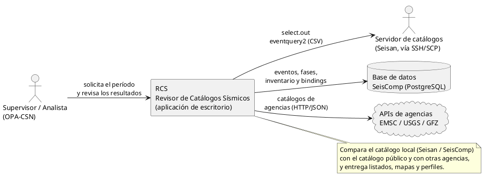
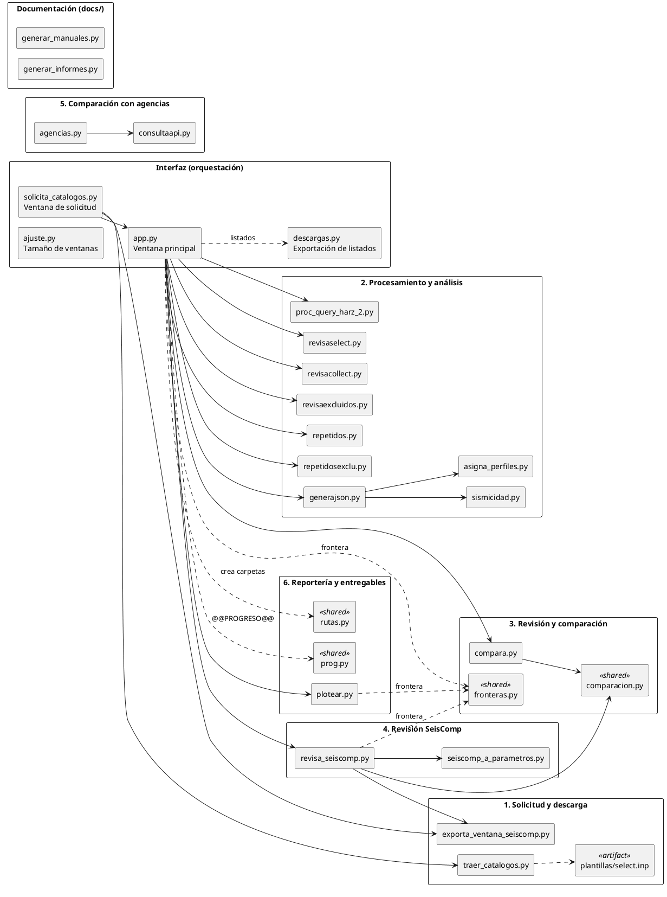
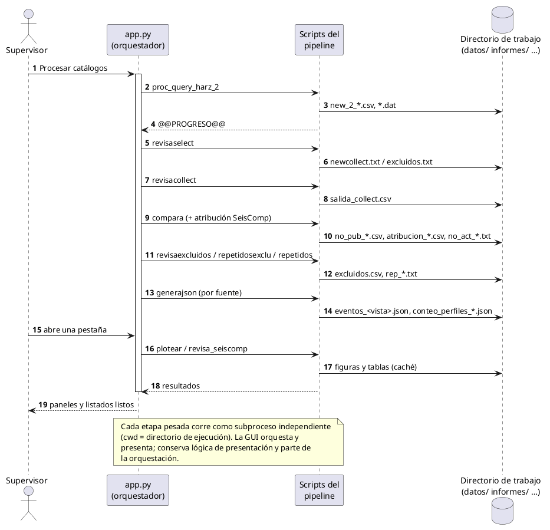
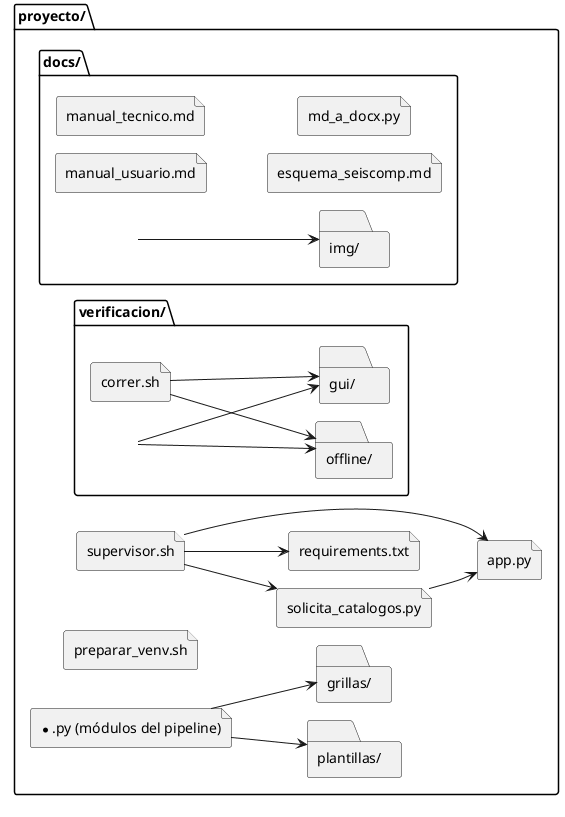
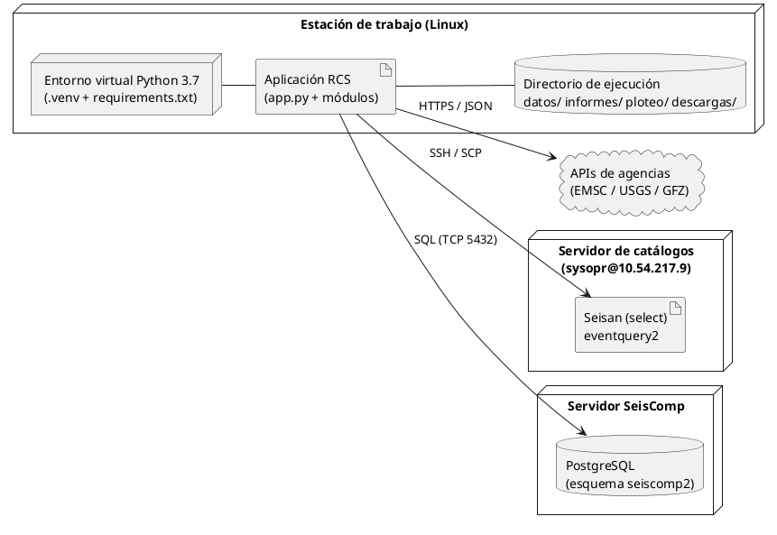
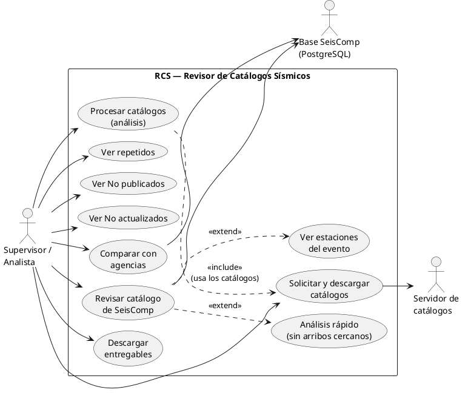
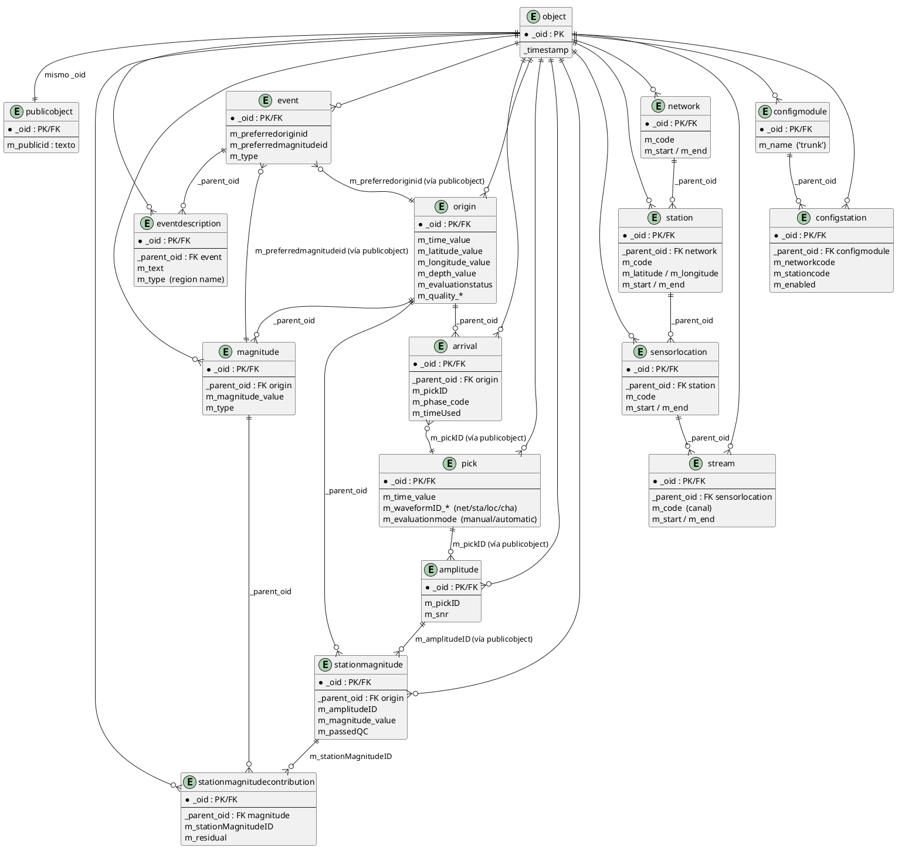
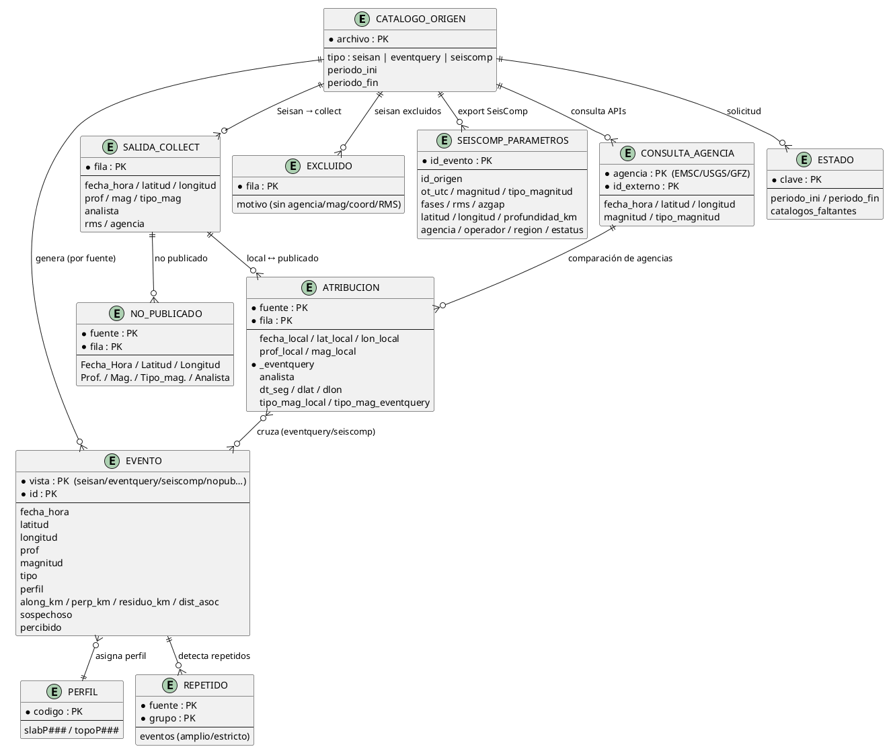

# Herramienta de revisión de catálogos de eventos sísmicos (RCS)

**Descripción del sistema**

H. Riquelme — OPA-CSN, Centro Sismológico Nacional, Universidad de Chile.

Versión 1.1 — 15 de octubre de 2026.

---

## Índice

1. [Introducción](#1-introducción)
2. [Necesidad operativa y alcance](#2-necesidad-operativa-y-alcance)
3. [Materiales y métodos](#3-materiales-y-métodos)
4. [Requerimientos](#4-requerimientos)
5. [Diseño de la solución](#5-diseño-de-la-solución)
6. [Pruebas](#6-pruebas)
7. [Conclusiones](#7-conclusiones)
8. [Bibliografía y referencias](#8-bibliografía-y-referencias)
9. [Anexos](#9-anexos)

---

## 1. Introducción

**RCS** (Revisor de Catálogos Sísmicos) es una aplicación de escritorio que
apoya la **revisión de los catálogos de eventos sísmicos** que produce y
publica la OPA-CSN. Toma como insumo tres catálogos de la misma ventana de
tiempo —el catálogo local de Seisan (`select.out`), el catálogo público
consultado por `eventquery2` y la exportación de la base de SeisComp— y los
cruza para responder preguntas operativas concretas de control de calidad:

- qué eventos del catálogo público **no fueron publicados** por el sistema;
- qué eventos publicados tienen parámetros que **no coinciden** con la solución
  local (no actualizados);
- qué eventos aparecen **repetidos** en cada fuente;
- qué soluciones quedaron **desactualizadas** respecto de SeisComp;
- qué eventos difieren respecto de **agencias internacionales** (EMSC, USGS,
  GFZ).

Este documento describe el sistema: su necesidad operativa, los requerimientos,
el diseño (con vistas de arquitectura y el modelo relacional de las bases que
consulta y de sus propios datos), las pruebas y las conclusiones. Está dirigido
a quien **opera** y a quien **mantiene o extiende** la herramienta. El detalle
de uso diario está en `manual_usuario.md` y el detalle técnico en
`manual_tecnico.md` (ver Anexo B).

---

## 2. Necesidad operativa y alcance

### 2.1 Contexto

La operación sísmica publica soluciones de forma continua. Controlar esa
publicación exige contrastarla contra el catálogo público y contra la base
institucional (SeisComp), tarea que se hacía de forma manual y dispersa: bajar
los catálogos, cruzarlos a ojo o con planillas, detectar duplicados y revisar
caso a caso. Ese proceso es lento, poco reproducible y difícil de auditar.

### 2.2 Objetivo general

Disponer de una herramienta única que **automatice la obtención, el cruce y la
presentación** de los catálogos, para que el supervisor concentre su tiempo en
la decisión y no en armar los datos.

### 2.3 Objetivos específicos

- Bajar de forma reproducible los catálogos de Seisan y eventquery y exportar
  la ventana de SeisComp para un período dado.
- Detectar eventos **no publicados**, **no actualizados** y **repetidos**.
- Atribuir cada discrepancia al **analista** y a la **estación** responsables.
- Revisar el catálogo de SeisComp (parámetros, fases, estaciones e inventario).
- Comparar las soluciones locales con las de **agencias internacionales**.
- Producir **entregables** (listados y mapas) listos para distribuir.
- Dejar **trazabilidad** de lo que se corrió y con qué insumos.

### 2.4 Alcance y exclusiones

**Incluye** la obtención de catálogos, el análisis, la revisión interactiva, la
comparación con agencias y la generación de entregables, en una estación de
trabajo Linux con acceso SSH al servidor de catálogos y a la base de SeisComp.

**No incluye** la corrección automática de soluciones, la publicación de
eventos, el procesamiento de formas de onda (los datos de disponibilidad de
ondas se dejan preparados, pero no se consultan) ni la operación de servidores
remotos.

---

## 3. Materiales y métodos

### 3.1 Antecedentes y origen del desarrollo

La herramienta no se diseñó desde cero: es el resultado de **integrar varios
programas pequeños** que un mismo desarrollador había construido por separado a
lo largo del tiempo, cada uno resolviendo una necesidad puntual de la revisión
(parsear el `select.out`, cruzar catálogos, detectar repetidos, dibujar mapas).
Esos programas operaban de forma aislada, con formatos y convenciones propias, y
su mantenimiento era manual.

El salto se produjo con la **incorporación de la inteligencia artificial como
asistente de desarrollo**. Sobre un entorno de trabajo moderno —**Visual Studio
Code**, **Python** y **Bash** como lenguajes, y herramientas de consulta de
**PostgreSQL**— y con la IA guiando el trabajo de forma iterativa, fue posible
**releer, homogeneizar e integrar** esos códigos base: unificar su organización
en un solo directorio de trabajo con una capa de rutas común, eliminar
duplicaciones, corregir inconsistencias y convertirlos en un sistema coherente,
reproducible y mantenible.

El resultado conserva la lógica ya validada en la operación y, a la vez,
aprovecha el desarrollo asistido para extender, documentar y probar el sistema
con mayor velocidad y consistencia.

### 3.2 Enfoque de desarrollo

El desarrollo fue **iterativo e incremental, guiado por el uso operativo**: cada
módulo se agregó a partir de una necesidad concreta de la revisión y se validó
usando catálogos reales de la operación. La herramienta prioriza **reproducir
el criterio del supervisor** antes que automatizar decisiones: el sistema
propone y ordena; el analista decide.

### 3.3 Patrón de arquitectura

La aplicación separa tres responsabilidades:

1. **Interfaz de orquestación** (`app.py`, Tkinter + `ttkbootstrap`): lanza cada
   etapa como **subproceso independiente**, muestra el avance y el registro, y
   presenta resultados. La GUI **no contiene lógica de negocio**.
2. **Módulos de proceso** (un script por etapa): ejecutables de forma autónoma y
   encadenables; leen y escriben archivos en el directorio de ejecución.
3. **Capa de acceso a datos**: red (SSH/SCP) y base (SQL), aislada en módulos
   propios (`traer_catalogos.py`, `exporta_ventana_seiscomp.py`).

El **directorio de trabajo** es el directorio desde donde se invoca la
aplicación; allí se resuelven las rutas relativas (`datos/`, `informes/`,
`ploteo/`, `descargas/`, `trabajo/`), centralizadas en `rutas.py`.

### 3.4 Tecnologías

- **Lenguaje**: Python 3.7.
- **Interfaz**: Tkinter con `ttkbootstrap`.
- **Análisis y mapas**: `numpy`, `pandas`, `scipy`, `matplotlib`, `cartopy`,
  `shapely`.
- **Base de datos**: PostgreSQL (SeisComp), vía `psycopg2`.
- **Red**: `ssh`/`scp` (con `SSH_ASKPASS`) y `requests` para las APIs de agencias.
- **Entorno**: entorno virtual (`.venv`) reproducido desde `requirements.txt`
  por `supervisor.sh` / `preparar_venv.sh`.

### 3.5 Método de trabajo

Cada corrida sigue el mismo ciclo: **solicitar** (bajar los tres catálogos) →
**procesar** (análisis por etapas) → **consultar** (pestañas de revisión) →
**entregar** (descargas). Los resultados se guardan como **caché** que la app
relee al reabrir (comparando fechas contra su entrada), de modo que solo se
rehace lo que cambió.

---

## 4. Requerimientos

### 4.1 Requerimientos funcionales por módulo

**Módulo 1 — Solicitud y descarga de catálogos.**

- RF1.1 Solicitar un período (inicio, fin) y una contraseña de servidor remoto.
- RF1.2 Bajar `select.out` (Seisan) y el CSV de eventquery por SSH/SCP.
- RF1.3 Exportar la ventana de SeisComp desde PostgreSQL para el mismo período.
- RF1.4 Reusar un catálogo si ya está en disco para esa ventana.
- RF1.5 Continuar aunque falle un catálogo, informando cuál quedó afuera.
- RF1.6 Re-exportar selectivamente el catálogo que falta o cambió.

**Módulo 2 — Procesamiento y análisis.**

- RF2.1 Normalizar el catálogo público al formato de Seisan.
- RF2.2 Separar los eventos revisables de los excluidos (sin agencia,
  magnitud, coordenadas o RMS).
- RF2.3 Armar el CSV maestro y los CSV por analista.
- RF2.4 Comparar público contra local (no publicados y no actualizados), con
  tolerancias amplia y estricta.
- RF2.5 Atribuir cada cruce a la solución de SeisComp.
- RF2.6 Detectar repetidos dentro de cada fuente y contra los excluidos.
- RF2.7 Asignar un perfil de subducción y clasificar eventos sospechosos.

**Módulo 3 — Revisión y comparación.**

- RF3.1 Comparar numéricamente los parámetros (lat, lon, prof, mag) a la
  precisión de los datos.
- RF3.2 Mostrar «No publicados» y «No actualizados», con el Δ por parámetro.
- RF3.3 Presentar el detalle y el Δ entre solución local y publicada.

**Módulo 4 — Revisión SeisComp.**

- RF4.1 Listar el catálogo de SeisComp con su detalle de parámetros.
- RF4.2 Mostrar las estaciones del evento (con y sin arribos).
- RF4.3 Distinguir picks **manuales** de **automáticos** y si entraron a la
  solución.
- RF4.4 Ejecutar el «Análisis rápido» de estaciones sin arribos cercanas.
- RF4.5 Ampliar el radio de un evento consultando la base.

**Módulo 5 — Comparación con agencias.**

- RF5.1 Consultar catálogos de EMSC, USGS y GFZ por HTTP/JSON.
- RF5.2 Normalizar y comparar contra la solución local publicada.
- RF5.3 Reutilizar la comparación si no cambió ningún insumo.
- RF5.4 Resumir la cobertura temporal real por agencia.

**Módulo 6 — Reportería, entregables y trazabilidad.**

- RF6.1 Generar mapas (planta y perfil de subducción) y paneles de análisis.
- RF6.2 Ofrecer la descarga de listados en CSV (UTF-8 con BOM) o TXT.
- RF6.3 Escribir los entregables automáticos solo con `RV_ENTREGABLES=1`.
- RF6.4 Registrar la traza de la app (`informes/app.log`, con rotación).

### 4.2 Requerimientos no funcionales

| Categoría | Requerimiento |
|---|---|
| Rendimiento | La estimación de tamaño de exportación se hace con una muestra, en décimas de segundo; las exportaciones grandes (> 200 MB) piden confirmación. |
| Estabilidad gráfica | Las ventanas pasan de 980×820 a un tope de 1920×1080; los diálogos emergentes se muestran solo con su tamaño y posición finales, centrados en el monitor de la ventana principal. |
| Usabilidad | Una sola pulsación («Procesar catálogos») deja toda la información disponible; los paneles pendientes se generan en segundo plano. |
| Portabilidad | Corre en Linux con Python 3.7+; el entorno se reconstruye desde `requirements.txt`. |
| Mantenibilidad | Un módulo por etapa, constantes de ajuste en mayúsculas, sin `argparse`, y rutas centralizadas en `rutas.py`. |
| Trazabilidad | Cada corrida deja registro y caché; los entregables se distinguen de la caché. |
| Seguridad de sesión | La contraseña remota se entrega con `SSH_ASKPASS`; no va por la línea de comandos ni se guarda. |
| Precisión numérica | Coordenadas a 3 decimales; profundidad y magnitud a 1; comparación numérica con tolerancia. |

---

## 5. Diseño de la solución

### 5.1 Diagrama de contexto

La herramienta interactúa con el supervisor y con tres fuentes externas: el
servidor de catálogos (Seisan), la base de SeisComp y las APIs de agencias.



### 5.2 Vistas de arquitectura (modelo 4+1)

Se documenta la arquitectura con el modelo **4+1**: cuatro vistas
complementarias y los escenarios que las validan.

#### 5.2.1 Vista lógica

Organiza el sistema en los seis módulos de la Sección 4, más la interfaz de
orquestación y las capas compartidas (`rutas.py`, `prog.py`, `comparacion.py`).



#### 5.2.2 Vista de procesos

Describe la dinámica de una corrida: `app.py` lanza cada script del pipeline
como subproceso y recibe, por la salida estándar, las líneas de progreso
(`@@PROGRESO@@`). La GUI no ejecuta lógica de negocio.



#### 5.2.3 Vista de desarrollo (implementación)

Muestra la organización del código y los artefactos: módulos en la raíz,
plantillas y grillas como insumos, `docs/` para la documentación y
`verificacion/` para las comprobaciones end-to-end.



#### 5.2.4 Vista física (despliegue)

La aplicación corre en una estación de trabajo Linux con su entorno virtual. Se
conecta por **SSH/SCP** al servidor de catálogos, por **SQL** a la base de
SeisComp (PostgreSQL) y por **HTTPS/JSON** a las APIs de agencias.



#### 5.2.5 Escenarios (casos de uso)

Los escenarios validan las cuatro vistas anteriores. Los casos de uso
principales y sus relaciones de `include`/`extend` se muestran a continuación.



| Caso de uso | Actor | Descripción |
|---|---|---|
| Solicitar y descargar catálogos | Supervisor | Baja Seisan, eventquery y la exportación de SeisComp. |
| Procesar catálogos | Supervisor | Corre el análisis por etapas. |
| Ver repetidos | Supervisor | Lista duplicados por fuente. |
| Ver No publicados | Supervisor | Eventos del público ausentes del local. |
| Ver No actualizados | Supervisor | Parametros publicados que difieren del local. |
| Revisar catálogo de SeisComp | Supervisor | Parámetros, fases y estaciones. |
| Ver estaciones del evento | Supervisor | `extend` de la revisión de SeisComp. |
| Análisis rápido | Supervisor | `extend`; estaciones sin arribos cercanas. |
| Comparar con agencias | Supervisor | Cruce con EMSC/USGS/GFZ. |
| Descargar entregables | Supervisor | Listados y mapas. |

### 5.3 Modelo relacional de la base de SeisComp

El proyecto consulta un subconjunto de la base de SeisComp (`seiscomp2`). Toda
la jerarquía comparte dos piezas: **`object`** (tabla base con `_oid` y
`_timestamp`) y **`publicobject`** (traduce `_oid` → `m_publicid`, el id público
en texto). Hay **dos formas de enlazar** objetos: por `_parent_oid` (entero) y
por **id público** a través de `publicobject`.

Un detalle relevante: `origin._parent_oid` **no** apunta al evento en esta base;
el evento se une a su origen **preferido** por
`event.m_preferredoriginid → publicobject → origin._oid`.



Las tablas y relaciones, y qué se consulta en cada recorrido (exportación,
selección de evento y ampliación de radio), están documentadas en detalle en
`docs/esquema_seiscomp.md`, con una versión importable en MySQL Workbench
(`docs/esquema_seiscomp_mysql.sql`).

---

## 6. Pruebas

### 6.1 Estrategia

La verificación del sistema se apoya en **dos niveles** complementarios:

- `tests/` — **tests unitarios** (pytest) de las funciones puras y de la
  interfaz, sin pantalla, base ni red en la corrida por defecto. Son rápidos y
  constituyen la red de seguridad para desarrollar y refactorizar. En la corrida
  por defecto suman **538 tests**; a eso se agregan los grupos que sí necesitan
  pantalla o base (**146** de interfaz y **36** de base de datos). El detalle está
  en el Anexo D.
- `verificacion/` — **comprobaciones end-to-end** (no tests unitarios) que
  ejercitan la aplicación de punta a punta: lógica de exportación, integración con
  base simulada, construcción de ventanas reales, diálogos y barras de
  herramientas. Se ejecutan con un runner único:

```
./verificacion/correr.sh          # offline + gui
./verificacion/correr.sh offline  # solo lógica, sin pantalla
```

| Grupo | Scripts | Necesita pantalla |
|---|---|---|
| `verificacion/offline/` | 10 | No |
| `verificacion/gui/` | 13 | Sí (`DISPLAY`) |

### 6.2 Tipos de prueba

- **Unitarias de lógica pura**: normalización de números y coordenadas,
  comparación numérica, cálculo de estaciones sin arribos y derivación de rutas.
- **De integración**: exportación de SeisComp con base simulada, integración de
  fases, comparación y atribución.
- **De sistema / interfaz**: construcción de las ventanas con `ttkbootstrap`
  (ventana de estaciones, panel, toolbar, diálogos, «recordar» y toggles).
- **De regresión visual/funcional**: viñeta de superposición y cobertura de
  agencias.

### 6.3 Resultado

La suite de verificación se ejecutó completa sobre el sistema tras la
reorganización del proyecto, con **23/23 comprobaciones OK** (10 offline + 13
GUI, 0 fallas).

La suite de **tests unitarios** corre completa y en verde: **538 tests** en la
corrida por defecto, más los **146** de interfaz y los **36** de base de datos
(ver Anexo D).

---

## 7. Conclusiones

- La herramienta reemplaza un control manual y disperso por un flujo único,
  reproducible y auditable, que va de la obtención de catálogos a los
  entregables.
- La separación **GUI orquestadora / módulos de proceso / capa de datos**
  resultó clave para mantener y extender el sistema: cada etapa es un script
  autónomo y la interfaz solo lanza y presenta.
- El uso de **caché releída** y de **entregables explícitos** reduce el trabajo
  repetido y evita dejar archivos que nadie pidió.
- La comparación **numérica con tolerancias** y la **trazabilidad** (registro,
  atribución por analista, perfiles y sospechosos) sostienen la confianza en los
  resultados.
- La suite de **verificación end-to-end (23/23)** da una red de seguridad para
  seguir evolucionando la interfaz y el flujo de revisión.

### 7.1 Trabajo futuro

- Integrar disponibilidad de formas de onda (SDS, scardac o FDSN Availability)
  para reemplazar el indicador indirecto de actividad de las estaciones.
- Ampliar la comparación con agencias y su cobertura temporal.
- Extender los tests unitarios de `tests/` a nuevas funciones puras a medida que
  se agreguen, complementando las comprobaciones end-to-end.

---

## 8. Bibliografía y referencias

- Centro Sismológico Nacional (CSN), Universidad de Chile. Portada institucional.
- OPA-CSN. Procedimientos internos de revisión de publicaciones sísmicas.
- SeisComp (gempa GmbH). Esquema de base de datos y documentación de usuario.
- Seisan (Universidad de Bergen). Formato `select.out` y utilidades de catálogo.
- `eventquery` — consulta del catálogo público de la red.
- Agencias internacionales: EMSC, USGS y GFZ (catálogos y APIs públicas).
- Documentación interna: `docs/manual_usuario.md`, `docs/manual_tecnico.md`,
  `docs/esquema_seiscomp.md`.

---

## 9. Anexos

### Anexo A. Modelo relacional de los datos propios

Además de las tablas de SeisComp, la herramienta define un modelo de datos
propio, materializado en archivos (CSV y JSON) que son la **caché** releída por
la app y la base de los **entregables**. Las claves y relaciones principales se
resumen así:



| Entidad (archivo) | Clave | Descripción |
|---|---|---|
| `CATALOGO_ORIGEN` (`select.out`, `eventquery_*.csv`, export SeisComp) | archivo | Insumos por ventana. |
| `EVENTO` (`datos/eventos_<vista>.json`) | vista + id | Evento con perfil, distancias y bandera de sospechoso. |
| `SALIDA_COLLECT` (`datos/salida_collect.csv`) | fila | Catálogo local normalizado (Seisan). |
| `EXCLUIDO` (`datos/excluidos.csv`) | fila | Descartados por falta de dato o RMS. |
| `ATRIBUCION` (`datos/atribucion_<fuente>.csv`) | fuente + fila | Un cruce local↔publicado con Δt/Δlat/Δlon. |
| `NO_PUBLICADO` (`datos/no_pub_desde_2_5_*estricto.csv`) | fuente + fila | Ausentes del local. |
| `SEISCOMP_PARAMETROS` (`datos/seiscomp_parametros.csv`) | id_evento | Export normalizado de SeisComp. |
| `PERFIL` (`grillas/slabP###`, `topoP###`) | código | Perfiles de subducción. |
| `CONSULTA_AGENCIA` (`datos/agencias/consultaapi_<AG>.csv`) | agencia + id | Catálogo por agencia. |
| `ESTADO` (`estado.json`) | clave | Período y catálogos faltantes. |
| `REPETIDO` (`informes/rep_*.txt`) | fuente + grupo | Duplicados amplios/estrictos. |

### Anexo B. Manuales del sistema

- `docs/manual_usuario.md` — funciones, botones y capturas (uso diario).
- `docs/manual_tecnico.md` — arquitectura, scripts, interfaces y parámetros
  ajustables; incluye el inventario de módulos, el flujo por etapa y las tablas
  de constantes.

### Anexo C. Esquema de SeisComp

- `docs/esquema_seiscomp.md` — descripción completa de las tablas y relaciones.
- `docs/esquema_seiscomp.txt` — la misma información sin el diagrama.
- `docs/esquema_seiscomp_mysql.sql` — versión importable en MySQL Workbench
  (diagrama EER); la base real es PostgreSQL.

### Anexo D. Tests unitarios

La suite de **tests unitarios** (pytest) vive en `tests/` y se documenta en
`docs/proyecto/tests_unitarios.md` (versión `.docx` en
`docs/versiones/tests_unitarios_v1.0_2026-10-15.docx`): grupos y marcadores,
índice módulo → grupo → archivo, arnés de regresión y cómo correrla. El índice
de cobertura resumido está además en `tests/COBERTURA.md` y las convenciones en
`tests/README.md`.
